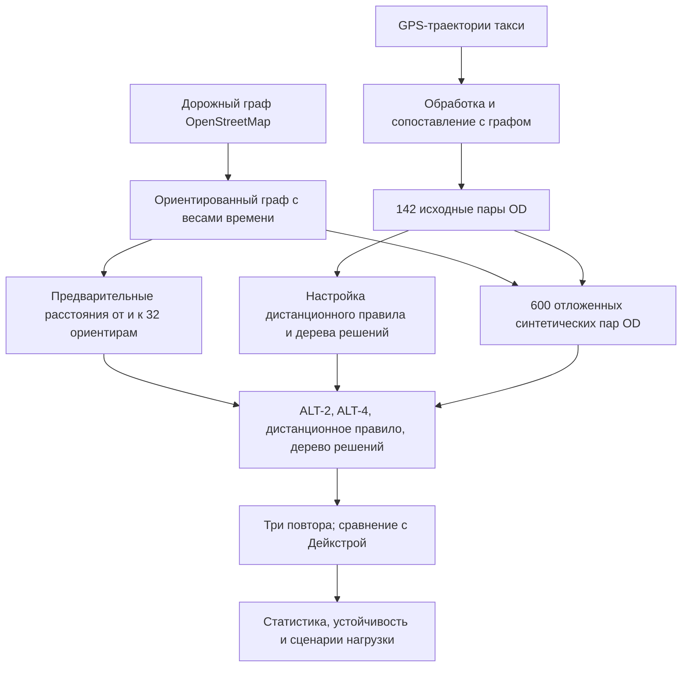

# Адаптивная маршрутизация ALT A* на дорожной сети Порту

Исследовательский проект по поиску кратчайших по времени маршрутов в **ориентированном дорожном графе Порту (Португалия)**. Основное внимание уделено адаптивному выбору числа ориентиров для алгоритма A* с эвристикой ALT (*A*, *Landmarks*, *Triangle inequality* — A*, ориентиры и неравенство треугольника), а также сравнению простого правила по расстоянию с подходом на основе машинного обучения.

В репозитории находятся исходный код экспериментов, подготовленные дорожные графы, промежуточные данные и результаты измерений. Проект предназначен для **исследования и воспроизведения экспериментов**, а не для предоставления готового сервиса навигации.

## Содержание

- [Постановка задачи](#постановка-задачи)
- [Основные результаты](#основные-результаты)
- [Быстрый старт](#быстрый-старт)
- [Воспроизведение экспериментов](#воспроизведение-экспериментов)
- [Методика и данные](#методика-и-данные)
- [Структура проекта](#структура-проекта)
- [Ограничения исследования](#ограничения-исследования)
- [Воспроизводимость и ссылка на версию кода](#воспроизводимость-и-ссылка-на-версию-кода)

## Постановка задачи

Алгоритм **A\*** находит маршрут минимальной стоимости с использованием эвристической оценки оставшегося пути. Метод **ALT** усиливает эту оценку за счёт заранее вычисленных расстояний до выбранных вершин-ориентиров и от них. Для ориентированного графа учитывается направление дуг; корректно построенная ALT-эвристика сохраняет оптимальность маршрута.

Большее число ориентиров может уменьшать количество раскрываемых вершин, но увеличивает затраты на их выбор и вычисление эвристики. Поэтому **минимум раскрытых вершин не обязательно соответствует минимуму времени выполнения запроса**.

В основном эксперименте сравниваются четыре стратегии:

| Стратегия в данных | Обозначение | Принцип выбора |
|---|---|---|
| `alt2` | ALT-2 | Используются 2 ориентира. |
| `alt4` | ALT-4 | Используются 4 ориентира. |
| `distance_gate` | Дистанционное правило | Выбираются 2 или 4 ориентира по географическому расстоянию между началом и концом маршрута. |
| `ml_tree` | Дерево решений | Число ориентиров выбирается компактной моделью машинного обучения. |

**Важно:** основной эксперимент оптимизирует вес дуги `osm_travel_time_s` — расчётное время движения на основе OpenStreetMap (OSM). Несмотря на название используемого графа, откалиброванный атрибут `conservative_travel_time_s` **не используется** в качестве целевой стоимости в этом сравнении.

## Основные результаты

Испытания выполнены на **600 отложенных синтетических парах «источник — назначение» (OD)**: по 200 коротких, средних и длинных маршрутов. Для каждой стратегии проведено три повтора измерений. Отложенные пары не пересекаются с исходными 142 GPS-парами, применёнными при разработке адаптивных правил.

| Стратегия | Медиана суммарного времени для 600 OD, мс | Изменение относительно ALT-2 | Раскрыто вершин¹ | Маршрутов с 4 ориентирами¹ |
|---|---:|---:|---:|---:|
| ALT-2 | 318,7884 | — | 127 833 | 0 |
| ALT-4 | 306,3306 | −3,91 % | 88 960 | 600 |
| **Дистанционное правило** | **292,5605** | **−8,23 %** | 99 098 | 159 |
| Дерево решений | 329,0217 | +3,21 % | 96 160 | 209 |

¹ Для числа раскрытых вершин и количества маршрутов с четырьмя ориентирами приведены значения первого повтора. Медиана времени рассчитана **по трём суммам времени обработки всех 600 OD**, а не как медиана задержек отдельных запросов.

При парном сравнении дистанционного правила с ALT-2 среднее изменение составляет **−45,26 мкс на OD**; 95%-й доверительный интервал, оценённый кластерным бутстрепом по вершинам назначения при независимой проверке сохранённых измерений, — **от −71,85 до −20,91 мкс/OD**. Отрицательное значение означает выигрыш дистанционного правила.

**Основной вывод:** в исследованной сбалансированной выборке дистанционное правило быстрее фиксированных ALT-2 и ALT-4 и дерева решений по медианному суммарному времени. Это **не означает универсального ускорения** для произвольной структуры транспортных запросов: выигрыш сосредоточен преимущественно на длинных маршрутах.

## Быстрый старт

### 1. Получение проекта

```bash
git clone https://github.com/qebrick/ml-gis-routing.git
cd ml-gis-routing
```

Все команды далее выполняются **из корня репозитория**: программы используют относительные пути к данным.

### 2. Создание виртуального окружения

Python **3.13.5** использовался для зафиксированных измерений.

**Windows (PowerShell):**

```powershell
py -3.13 -m venv .venv
.\.venv\Scripts\Activate.ps1
python -m pip install --upgrade pip
```

**Linux / macOS:**

```bash
python3.13 -m venv .venv
source .venv/bin/activate
python -m pip install --upgrade pip
```

### 3. Установка зависимостей

В зафиксированной версии проекта отсутствует файл `requirements.txt` или lock-файл. Для работы с основными маршрутными экспериментами необходимы:

```bash
python -m pip install numpy pandas pyarrow networkx osmnx scikit-learn scipy
```

Библиотеки для геообработки (в том числе Shapely и PyProj) обычно устанавливаются вместе с OSMnx; некоторые вспомогательные исследовательские сценарии используют дополнительные пакеты. Для точного воспроизведения программной среды основного эксперимента зафиксированы следующие версии:

| Компонент | Версия |
|---|---|
| Python | 3.13.5 |
| pandas | 3.0.6 |
| NumPy | 2.5.4 |
| NetworkX | 3.7 |
| scikit-learn | 1.9.1 |

Версии OSMnx, SciPy и PyArrow в опубликованных метаданных не зафиксированы. Поэтому приведённая команда — **практическая установка**, а не полностью воспроизводимая спецификация окружения.

### 4. Проверка опубликованных результатов без повторного замера времени

В репозитории уже имеются сохранённые результаты основного эксперимента. Для пересчёта итоговых таблиц и проверки полноты данных выполните:

```bash
python -m src.routing.finalize_porto_alt_results
python -m src.routing.analyze_porto_heldout_alt
python -m src.routing.audit_porto_alt_robustness
python -m src.routing.analyze_porto_alt_workload
```

Сценарии проверяют состав выборки, рассчитывают агрегированные показатели, парные различия, анализ устойчивости и чувствительность к доле длинных маршрутов. Отчёты формируются в каталоге `reports/`, а таблицы и метаданные — в `data/processed/`.

> Эта процедура **пересчитывает статистику по ранее сохранённым измерениям**, но не выполняет поиск маршрутов заново и не измеряет новое время работы A*.

## Воспроизведение экспериментов

### Повторное измерение маршрутизации

Для нового запуска сравнения четырёх стратегий используйте:

```bash
python -m src.routing.benchmark_porto_heldout_alt
```

Сценарий загружает подготовленный граф, набор ориентиров, обучающие признаки и фиксированный набор из 600 тестовых OD; строит необходимые таблицы расстояний ALT, обучает дерево решений, прогревает выполнение, выполняет три повтора и проверяет найденную стоимость маршрутов относительно алгоритма Дейкстры.

**Перед запуском:**

- Убедитесь, что зависимости установлены и подготовленные данные доступны после клонирования.
- Сохраните копию исходных результатов: сценарий перезаписывает таблицу измерений.
- Не сопоставляйте абсолютные задержки, полученные на разных компьютерах, как аппаратно-независимую характеристику алгоритма.

Затем можно повторно выполнить четыре команды статистической обработки из раздела «Быстрый старт».

### Формирование отложенной выборки

```bash
python -m src.routing.create_heldout_porto_od
```

При наличии исходной таблицы GPS-пар и подготовленного графа сценарий формирует 600 синтетических OD в крупнейшей сильно связной компоненте, исключая пересечения с GPS-парами. Используется начальное значение генератора случайных чисел **20261016**. Опубликованная контрольная сумма содержания выборки (SHA-256):

```text
d93bc12a37bb62b8a22a4fae55a6c5bd3bd863aa1a705f4b413cd47204d14b1e
```

Фиксированный набор тестовых пар **не применялся для настройки** дистанционного правила или дерева решений.

### Предварительная обработка GPS и дорожного графа

В проекте предусмотрены отдельные сценарии для загрузки дорожной сети, обработки траекторий, сопоставления GPS-точек с дорожным графом и оценки весов дуг. Например:

```bash
python -m src.data.download_graph
python -m src.data.prepare_trajectories --input data/raw/train.csv --limit 10000
```

Вторая команда требует собственного экземпляра исходных траекторий такси Порту в формате CSV. **Исходный `train.csv` не включён в репозиторий.** Значение `--limit 10000` — параметр приведённого примера и значение по умолчанию, а не доказательство того, что все опубликованные данные получены именно при таком запуске. Подготовка промежуточных данных включает дополнительные этапы, поэтому эти две команды **не являются полным конвейером** восстановления всех опубликованных артефактов.

## Методика и данные

### Схема исследования



**Уточнение:** стрелка от исходных GPS-пар к тестовой выборке означает использование границ классов расстояния и исключение совпадающих пар; сами 600 OD создаются синтетически, а не извлекаются как реальные поездки.

### Основные параметры

| Параметр | Значение |
|---|---|
| Тип сети | Ориентированный автомобильный граф Порту на основе OSM |
| Вес дуги в основном сравнении | `osm_travel_time_s` |
| Всего предварительно выбранных ориентиров | 32 |
| Используемое число ориентиров в запросе | 2 или 4 |
| Обучающие GPS-пары OD | 142 |
| Отложенные синтетические OD | 600: по 200 в трёх классах расстояния |
| Повторы измерения | 3 |
| Порог дистанционного правила | 2914,709 м географического расстояния |
| Дерево решений | Максимальная глубина 2; минимум 5 объектов в листе |
| Оценка при обучении | Групповая перекрёстная проверка по вершине назначения (5 блоков) |
| Порог выбора модели | 25 прогнозируемых сэкономленных раскрытий |
| Проверка оптимальности | Сопоставление стоимости с алгоритмом Дейкстры |

На этапе подготовки ALT выполняются вычисления расстояний **от** каждого ориентира и **к** нему, необходимые для направленного графа. Их стоимость **не включается** во время обработки отдельного запроса.

Суммарное время запроса включает выбор стратегии/ориентиров и сам поиск. В данных `selection_ms` уже включает `decision_ms`: **эти показатели нельзя складывать повторно**.

### Структура проекта

```text
ml-gis-routing/
├── src/
│   ├── data/              # загрузка графа, GPS, сопоставление с сетью
│   ├── routing/           # A*, ALT, выбор ориентиров и эксперименты
│   ├── ml/                # подготовка признаков, модели, проверки
│   ├── evaluation/        # пакет для задач оценки
│   └── models/            # пакет моделей
├── data/
│   ├── raw/               # локальные исходные данные (не публикуются)
│   ├── graphs/            # подготовленные GraphML-графы
│   └── processed/         # Parquet, CSV и JSON с результатами
└── .gitignore
```

Ключевые сценарии эксперимента находятся в `src/routing/`: формирование тестовой выборки, основной замер, итоговая агрегация, аудит устойчивости и анализ состава нагрузки. Другие сценарии отражают предварительные и альтернативные исследовательские подходы.

В исходном исследовательском снимке не было файла зависимостей и лицензии; каталог готовых отчётов создаётся при выполнении сценариев анализа.

## Ограничения исследования

1. **Синтетическая тестовая нагрузка.** Выборка искусственно сбалансирована по дальности (200/200/200) и не доказывает такой же выигрыш на естественном потоке запросов. При малой доле длинных маршрутов дистанционное правило может проигрывать ALT-2.
2. **Зависимость задержек от среды.** Измерения получены в Python на конкретном оборудовании; результаты в миллисекундах нельзя напрямую переносить на другие платформы и реализации.
3. **Три повтора — не новые маршруты.** Они отражают вариативность времени при том же наборе OD и не увеличивают число независимых тестовых пар.
4. **Различие функций стоимости.** Результат основного эксперимента относится к OSM-времени `osm_travel_time_s`; точность времени реальных поездок по скорректированным весам этим сравнением не устанавливается.
5. **Неполнота исходных данных.** Сырые GPS-траектории отсутствуют; поэтому полный путь от первоначального CSV до всех промежуточных таблиц не воспроизводится только по опубликованному репозиторию.
6. **Статистическая и вычислительная воспроизводимость различаются.** Повторный расчёт опубликованной статистики не равнозначен независимому повторному измерению всех алгоритмов на той же аппаратной платформе.

## Воспроизводимость и ссылка на версию кода

Числовые значения и структура данных в README соответствуют состоянию репозитория на коммите:

[`34bf510aa99bb1360a740b704d017486b0260fcd`](https://github.com/qebrick/ml-gis-routing/commit/34bf510aa99bb1360a740b704d017486b0260fcd)

Для работы именно с этой версией после клонирования можно выполнить:

```bash
git checkout 34bf510aa99bb1360a740b704d017486b0260fcd
```

**Аппаратная платформа исходных измерений:** Intel Core i5-9300HF (2,40 ГГц, 4 ядра / 8 потоков), 16 ГБ ОЗУ, Windows 11 Home 64-bit (сборка 26200), Python 3.13.5.

В опубликованных метаданных приведены параметры эксперимента и контрольная сумма выборки. Независимый пересчёт статистики из Parquet подтвердил структуру **7200 строк** (600 OD × 4 стратегии × 3 повтора) и агрегированные результаты, указанные выше.

При использовании результатов в научной работе рекомендуется ссылаться на репозиторий **с полным SHA коммита**, указывать дату обращения и отдельно описывать тестовую нагрузку и аппаратную платформу. DOI публикации и формальная лицензия на код на момент подготовки этого README в репозитории не указаны.
